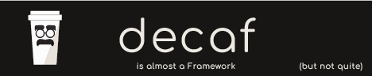

[](https://decaf-ts.github.io/nest-template/)
## Decaf Nest Template

Template repository for [decaf-ts](https://github.com/decaf-ts) NestJS backends: REST APIs generated from your models, Keycloak authentication and live events (SSE) — out of the box, tested end-to-end.


[](https://github.com/decaf-ts/nest-template/actions/workflows/nodejs-build-prod.yaml)
[](https://github.com/decaf-ts/nest-template/actions/workflows/codeql-analysis.yml)[](https://github.com/decaf-ts/nest-template/actions/workflows/snyk-analysis.yaml)
[](https://github.com/decaf-ts/nest-template/actions/workflows/pages.yaml)
[](https://github.com/decaf-ts/nest-template/actions/workflows/release-on-tag.yaml)


Documentation [here](https://decaf-ts.github.io/nest-template/), Test results [here](https://decaf-ts.github.io/nest-template/workdocs/reports/html/test-report.html) and Coverage [here](https://decaf-ts.github.io/nest-template/workdocs/reports/coverage/lcov-report/index.html)


### Description

`@decaf-ts/nest-template` is the starting point for a [NestJS](https://nestjs.com) backend built on decaf-ts. Create a repository from it, replace the demo models with your own, and you get:

- **A REST API per model**, with OpenAPI. [`@decaf-ts/for-nest`](https://github.com/decaf-ts/for-nest) generates a controller for every model registered with the persistence adapter: CRUD, bulk operations, queries (`listBy`, `findBy`, `paginateBy`, `find`, ...), aggregations and prepared statements, all documented in Swagger (`/docs`).
- **Keycloak authentication** (`@decaf-ts/integrations/nest`). Bearer tokens are verified against the realm's JWKS. User, organization, roles and namespaces are extracted from the token and bound to the request context, so `@createdBy`/`@updatedBy` and the logs know who is calling.
- **Declarative authorization at every level**. Model roles (`@roles`), model namespaces (`@namespace`), controller config (`@controllerConfig({ auth })` or module-level `controllerConfig`), per-route decorators (`@Public`, `@Auth`, `@RequireRoles`, `@RequireNamespaces`) and route blocking (`@BlockOperations`).
- **Live events**. Every write is pushed over Server-Sent Events (`/events`), authenticated with the same Keycloak handler, in broadcast or subscription mode. Decaf frontends consume them through `@decaf-ts/for-http`'s `HttpAdapter` and the standard `Observer` API.
- **Zero infrastructure to start**. Persistence uses decaf's in-memory adapter, so the app and its whole e2e suite run without a database or a Keycloak (the tests embed a JWKS-serving Keycloak stand-in). A `docker-compose` with a pre-provisioned Keycloak realm is included for local development.
- **End-to-end tests through the HttpAdapter**. Every model, every permission rule and the events API are exercised over HTTP with `@decaf-ts/for-http`'s `AxiosHttpAdapter`, the same client a decaf frontend uses.

#### The demo domain

A small coffee shop. Each model demonstrates a different way of protecting the generated API:

| Model / route | Endpoint | Protection | How |
|---|---|---|---|
| `Category` | `/category` | public, read-only | `@controllerConfig({ auth: { public: true } })` + `@BlockOperations([...])` (seeded server-side) |
| `Product` | `/product` | role `catalog-manager` on every route | model-level `@roles([...])`; aggregations and bulk enabled by `@controllerConfig` |
| `Order` | `/customer-order` | role `customer`; no DELETE | module-level `controllerConfig: { Order: { auth: { roles } } }` + `@BlockOperations([DELETE])` |
| `Ticket` | `/ticket` | role `agent` **and** namespace `support` | `@roles([...])` + `@namespace([...])` |
| `Article` | `/article` | read: public; queries: `reader`; writes: `editor`; delete: `admin` | hand-built controller (`FromModelController.create`) decorated route by route |
| `GET /me` | `/me` | any authenticated user | `@Auth()` on a custom controller |
| `GET /reports/sales` | `/reports/sales` | role `manager` **and** namespace `sales` | `@RequireRoles` + `@RequireNamespaces`, repositories injected with `@Repository(Model)` |
| `GET /public/status` | `/public/status` | public | `@Public()` and the `/public` path prefix |
| events | `/events` | any authenticated user | `observerOptions: { authenticate: true }` |

`createdBy` (or `customer` on orders) is always the authenticated user, whatever the payload says. It is `@readonly()`, so updates cannot rewrite it.

#### Architecture

```
src/
├── main.ts                 process entrypoint (node lib/main.js)
├── bootstrap.ts            createApp(): Nest app + decaf NestBootstraper (helmet, CORS, error filter, swagger)
├── app.module.ts           AppModule.forRoot(): DecafModule (persistence, generated controllers, events) + auth + custom controllers
├── config/environment.ts   typed environment (PORT, KEYCLOAK__*, JWT__*, EVENTS__*, ...)
├── persistence/            adapter bootstrap (RAM by default) — imported before any model
├── auth/                   Keycloak auth handler, jwt service (JWKS), roles & namespaces, AuthModule
├── models/                 demo models (shareable with a frontend)
├── controllers/            custom controllers (/me, /public/status, /reports/sales, per-route Article controller)
└── seed.ts                 server-owned reference data
```

A request goes through for-nest's `AuthMiddleware`, which primes the request context from the token. Then the `AuthInterceptor` asks the **Keycloak handler** to verify the token (JWKS) and check route and model roles and namespaces. The request-to-context transformer maps the user onto the adapter flags, and finally the generated controller calls the model's `ModelService`/`Repository`. Every committed write is dispatched to the observers, including the SSE stream of each connected client.


### How to Use

- [Quick start](#quick-start)
- [Configuration](#configuration)
- [Calling the API](#calling-the-api)
- [Adding your own models](#adding-your-own-models)
- [Protecting the API](./workdocs/tutorials/Authentication.md)
- [Live events](./workdocs/tutorials/Live%20Events.md)
- [Testing](./workdocs/tutorials/Testing.md)
- [Developer guide (scripts, CI/CD, releases, IDE)](./workdocs/tutorials/For%20Developers.md)

#### Quick start

Requirements: Node.js >= 20, npm >= 10, Docker (optional, for Keycloak). The app is an ES module (`"type": "module"`), like NestJS 12.

```bash
npm install
cp .env.example .env

# a Keycloak with the `decaf` realm, demo roles and demo users (password = username)
npm run keycloak:up            # http://localhost:8180 (admin/admin)

npm run start:dev              # http://localhost:3000 — swagger at /docs
```

Or run the whole stack in containers: `docker compose -f docker/docker-compose.yml --profile api up -d --build`.

Demo users (realm `decaf`, client `decaf-backend`):

| user | roles |
|---|---|
| `catalog` | `catalog-manager` |
| `customer` | `customer` |
| `agent` | `agent`, `namespace:support` |
| `reader` / `editor` / `admin` | `reader` / `+editor` / `+admin` |
| `manager` | `manager`, `namespace:sales` |

```bash
TOKEN=$(curl -s http://localhost:8180/realms/decaf/protocol/openid-connect/token \
  -d grant_type=password -d client_id=decaf-backend -d username=catalog -d password=catalog | jq -r .access_token)

curl -H "Authorization: Bearer $TOKEN" http://localhost:3000/me
curl -H "Authorization: Bearer $TOKEN" -H 'content-type: application/json' \
  -d '{"sku":"ESP-001","name":"Espresso beans","category":"coffee","price":12.5,"stock":40}' \
  http://localhost:3000/product
curl -N -H "Authorization: Bearer $TOKEN" http://localhost:3000/events   # live events
```

#### Configuration

All settings come from the environment (`.env` is loaded by `npm run start:dev`). See [`.env.example`](./.env.example).

`AppEnvironment` (`src/config/environment.ts`) is a decaf-ts `Environment`, available everywhere: each setting is read from `process.env` when accessed, named after its path (`camelCase` → `UPPER_SNAKE`, nested keys joined with `__`), and falls back to the default. Booleans are `true`/`false`.

| Variable | Default | Description |
|---|---|---|
| `PORT` / `HOST` | `3000` / `0.0.0.0` | http listener |
| `CORS_ORIGINS` | `*` | comma separated allowed origins |
| `SWAGGER` | `true` | swagger UI on `/docs`, OpenAPI json on `/docs-json` |
| `SEED` | `true` | seeds the demo categories |
| `KEYCLOAK__URL` | — | Keycloak base url; tokens are verified against `<url>/realms/<realm>/protocol/openid-connect/certs` |
| `KEYCLOAK__REALM` | `decaf` | realm issuing the tokens |
| `KEYCLOAK__CLIENT_ID` | `decaf-backend` | this backend's client id |
| `JWT__VERIFY_URL` | — | explicit JWKS url (overrides the Keycloak-derived one) |
| `JWT__SECRET` | — | HS256 shared secret, used only when no JWKS url is set |
| `JWT__CLOCK_TOLERANCE_SECONDS` | `5` | accepted clock skew |
| `JWT__ALLOW_DECODE_ONLY` | `false` | **development only**: accept tokens without verifying signatures |
| `LOG_ACCESS` | `false` | OCSF-style access logs (class_uid 3001/3002) |
| `EVENTS__ENABLED` | `true` | live events endpoint |
| `EVENTS__PATH` | `/events` | SSE endpoint path |
| `EVENTS__SUBSCRIPTION_MODE` | `false` | clients receive only the tables they subscribe to |
| `EVENTS__AUTHENTICATE` | `true` | run the Keycloak handler on the stream and subscription endpoints |

With no `KEYCLOAK__URL`, `JWT__VERIFY_URL` or `JWT__SECRET`, every authenticated request is rejected, and a warning is logged at boot.

#### Calling the API

From another decaf application (a frontend, another service), use `@decaf-ts/for-http` with the same model classes as `src/models` (this repository ships a Docker image, not an npm package, so share the models through your own models package or copy them):

```ts
import { AxiosHttpAdapter, RestService } from "@decaf-ts/for-http";
import { Product } from "./models"; // the same classes as src/models

const adapter = new AxiosHttpAdapter({
  protocol: "https",
  host: "api.example.com",
  eventsListenerPath: "/events",
  eventHeaderResolver: () => ({ Authorization: `Bearer ${getToken()}` }), // SSE + subscriptions
});
// REST calls: add the bearer token, e.g. by overriding `request` (see tests/e2e/harness/client.ts)

const products = new RestService(adapter, Product);
await products.create(new Product({ sku: "ESP-001", name: "Espresso", category: "coffee", price: 12, stock: 4 }));
const cheapest = await products.listBy("price", "asc");
const stop = products.observe({ refresh: async (table, op, id) => console.log(table, op, id) });
```

#### Adding your own models

1. Create the model in `src/models` (decorate it with `@uses(PersistenceFlavour)`, `@table`, `@model()`, `@pk`, `@column`, validation decorators, ...). Export it from `src/models/index.ts`.
2. Choose how it is protected: `@roles`, `@namespace`, `@controllerConfig({ auth })`, the module-level `controllerConfig`, or a hand-built controller ([guide](./workdocs/tutorials/Authentication.md)).
3. That's it: the controller, OpenAPI documentation and events are generated. Add an e2e suite under `tests/e2e` (copy `product.e2e.ts`).

To move to a real database, swap the RAM adapter in `src/persistence/index.ts` for another decaf adapter (e.g. `@decaf-ts/for-typeorm`, `@decaf-ts/for-nano`, `@decaf-ts/for-fabric`) together with its request-to-context transformer, and update `src/persistence/flavour.ts`.


### Related

- [`@decaf-ts/for-nest`](https://github.com/decaf-ts/for-nest) — NestJS integration: generated model controllers, auth module, events (SSE), bootstrapper.
- [`@decaf-ts/for-http`](https://github.com/decaf-ts/for-http) — HTTP adapter (client) and the framework-agnostic server pieces (auth handler base, controller factory).
- [`@decaf-ts/integrations`](https://github.com/decaf-ts/integrations) — Keycloak auth handlers (`/nest`), Keycloak admin services and other integrations.
- [`@decaf-ts/core`](https://github.com/decaf-ts/core) — repositories, services, adapters, queries and observers.
- [`@decaf-ts/crypto`](https://github.com/decaf-ts/crypto) — JWT verification (JWKS / HS256).

[](https://github.com/decaf-ts/nest-template)


### Social

[](https://www.linkedin.com/in/TiagoVenceslau/)


#### Languages


## Getting help

If you have bug reports, questions or suggestions, please [create a new issue](https://github.com/decaf-ts/nest-template/issues/new/choose).

## Contributing

I am grateful for any contributions made to this project. Please read [this](./workdocs/tutorials/Contributing.md) to get started.

## Supporting

The first and easiest way you can support it is by [Contributing](./workdocs/tutorials/Contributing.md). Even just finding a typo in the documentation is important.

Financial support is always welcome and helps keep both me and the project alive and healthy.

So if you can, if this project in any way. either by learning something or simply by helping you save precious time, please consider donating.

## License

This project is released under the [MIT License](./LICENSE.md).

By developers, for developers...