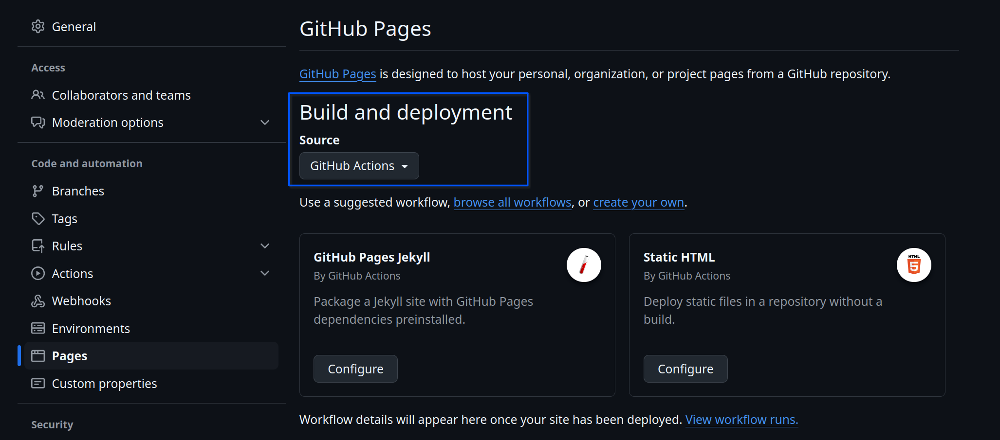
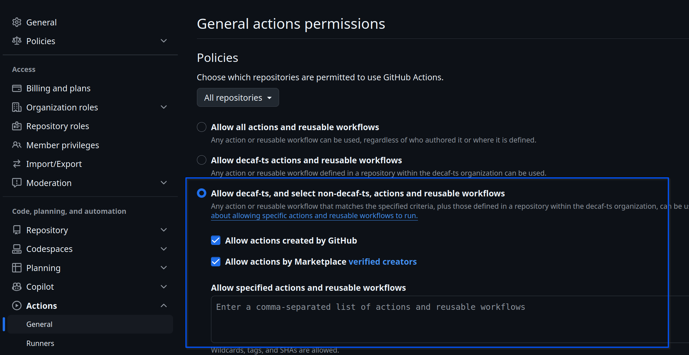
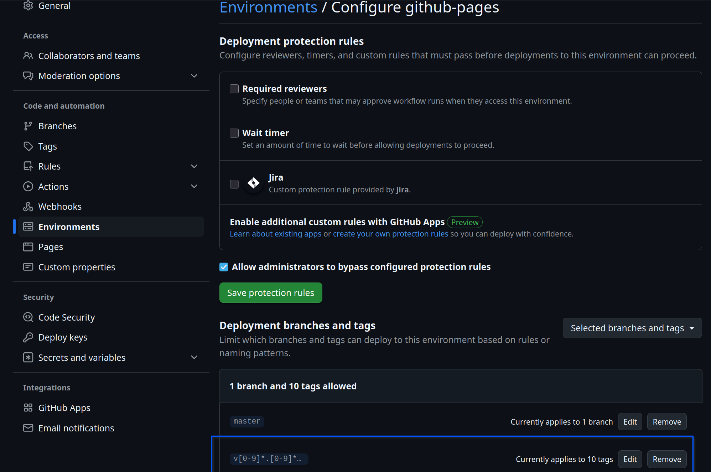

## **_Initial Setup_**

#### if you use GitHub

create a new project using this one as a template.

clone it `git clone <project>` and navigate to the root folder `cd <project>`

enroll your access token once via `decaf utils credentials setup` (stored in the OS keychain with env-var fallback - never inside the repository).

run `npm run set-git-auth` to register the OS-native git credential helper (`decaf utils credentials git-helper`)

#### If your project has private dependencies or publishes to private npm registries, create an `.npmrc` containing:

```text
@<scope1>:registry=https://<ADDRESS>.com/api/v4/packages/npm/
@<scope2>:registry=https://<ADDRESS>.<DOMAIN>.com/api/v4/packages/npm/
//<ADDRESS>.<DOMAIN>.com/:_authToken=${TOKEN}
//<ADDRESS>.<DOMAIN>.com/api/v4/groups/<GROUP_ID>/packages/npm/:_authToken=${TOKEN}
//<ADDRESS>.<DOMAIN>.com/api/v4/projects/<PROJECT_ID>/packages/npm/:_authToken=${TOKEN}
```

Changing:

- <ADDRESS> to `gitlab` or `github` (or other);
- <DOMAIN> to your domain if any (if you are using plain gitlab or GitHub, remove "<DOMAIN>" and the extra dot);
- <GROUP_ID> to your project's group id (if any). otherwise remove this line
- <PROJECT_ID> to your project's id

### Installation

Run `npm install` (or `npm run do-install` if you have private dependencies - it resolves the npm token via `decaf utils credentials`) to install the dependencies:

If this is the first time you are running this command, it will also (according to your choices:

- update this repository's dependencies to their latest version;
- creates the various token files which you can leave empty unless you have private dependencies or publish to private registries
- delete the `postinstall` script from `package.json`;
- try to commit the updated `package.json` and deleted files (having ssh access helps here);

### Scripts

The repository exposes the following npm scripts:

#### Setup and Maintenance

- `do-install` – resolves the npm token via `decaf utils credentials` into the `NPM_TOKEN` environment variable and runs `npm install`, which is handy when private registries require an auth token.
- `update-dependencies` – upgrades all dependencies that start with `@decaf-ts/` to their latest version.
- `update-scripts` – downloads the latest GitHub workflows, configs, and templates from the [ts-workspace](https://github.com/decaf-ts/ts-workspace) template repository.
- `sync-codex` – copies the prompts under `./.codex/prompts` into `~/.codex/prompts` so Codex CLI can reuse them.
- `on-first-run` – bootstraps the project by calling `update-scripts` with the `--boot` flag.
- `set-git-auth` – registers the OS-native git credential helper via `decaf utils credentials git-helper`; run this once per repository.
- `flash-forward` – bumps every dependency to the latest version via `npm-check-updates` and re-installs.
- `reset` – restores the repository to the state of the default branch (wipes the working tree and re-installs dependencies); use with care.

#### Build and Quality

- `build` – `nest build`: the Nest CLI type-checks `src` and compiles it to `lib` with its SWC builder (ES modules, source maps), adding the `.js` extensions Node needs to the extensionless imports (see `nest-cli.json` and `tsconfig.build.json`).
- `build:prod` – alias of `build`.
- `start` – runs the compiled application (`node lib/main.js`).
- `start:dev` / `start:debug` – builds and runs the application with `.env` loaded (and the inspector, for `start:debug`).
- `keycloak:up` / `keycloak:down` – starts/stops the local Keycloak (realm `decaf`) from `docker/docker-compose.yml`.
- `lint` – executes ESLint across the repository.
- `lint-fix` – runs ESLint with `--fix` to automatically resolve issues when possible.
- `typecheck` – type-checks `src` and `tests` (ts-jest does not).
- `prepare-pr` – runs linting, type-checking, production build, coverage and documentation ahead of opening a pull request.

#### Documentation Assets

- `drawings` – converts every Draw.io file under `workdocs/drawings` into PNG assets and copies them into `workdocs/resources`.
- `uml` – renders each PlantUML diagram found in `workdocs/uml` to PNG and copies the result to `workdocs/resources`.
- `docs` – clears the `docs` folder and rebuilds the static documentation site via `build-scripts --docs`.
- `publish-docs` – publishes the Markdown content under `workdocs/confluence` to Confluence through the official `markdown-confluence` container.

#### Docker

- `docker:login` – authenticates against `ghcr.io` using registry credentials resolved via `decaf utils credentials`.
- `docker:build` – builds the application image (`ghcr.io/decaf-ts/nest-template:<version>` and `:latest`).
- `docker:publish` – pushes the versioned and `latest` images.

### Tests

All automated test scripts live in `package.json` (see the [testing guide](./Testing.md)):

- `test` – default entry point; forwards to `test:all`.
- `test:unit` – runs Jest against `tests/unit`.
- `test:e2e` (alias `test:integration`) – runs the end-to-end suites under `tests/e2e` (in band).
- `test:all` – executes the entire Jest test suite under `tests`.
- `test:circular` – checks the source for circular dependencies using `dpdm`.
- `prepare-it-tests` – hook called by the shared CI workflows before any test/coverage run. It is a no-op here: the e2e suites are self-contained.
- `coverage` – wipes previous coverage JSON files and runs the full test suite with the coverage-specific Jest config to emit reports and badges.

## Linting

This repo comes with eslint + prettier preconfigured to the default standards.

Please configure your IDE to recognize these files and perform automatic validation and fixes on save:
 - Webstorm:
   - eslint recommended setup preconfigured under `.idea/jsLinters/eslint.xml`
   - prettier recommended setup preconfigured under `.idea/prettier.xml`
 - VSCode(ium):
   - eslint recommended setup preconfigured under `.vscode/settings.json`
   - prettier recommended setup preconfigured under `.vscode/settings.json`

## Testing

See the [testing guide](./Testing.md).

- `jest.config.cjs` is the base config (ts-jest, `tests/setup.ts` quiets the decaf logger).
- `workdocs/reports/jest.coverage.config.cjs` adds coverage, the junit/html reporters and the thresholds.

## Documentation

The repository proposes a [way to generate documentation](./Documentation.md) that while still not ideal, produces very consistent results.

There are 3 steps in generating the documentation (automated in CI):

- `npm run drawings` - generates png files from each drawing in the `workdocs/drawings` folder and moves them to the `workdocs/resources` folder (requires Docker);
- `npm run uml` - generates png files from each PlantUML diagram in the `workdocs/uml` folder and moves them to the `workdocs/resources` folder (requires Docker);
- `npm run docs` - (should be ran after `npm run coverage` to include test results and coverage) this has several stages, defined under the `npx build-docs`):
  - compiles the Readme file via md compile:
    - enables keeping separate files for sections that are then joined into a single file;
    - Allows keeping specific files in the jsdoc tutorial folder so they show up on their own menu;
  - compiles the documentation from the source code using jsdoc:
    - uses the better docs template with the category and component plugins
    - uses the mermaid jsdoc plugin to imbue uml diagrams in the docs
    - includes a nav link to the test coverage results;
  - copies the jsdoc and mds to `/docs`;
  - copies the `./workdocs/{drawings, uml, assets, resources}` to `./docs`;

The produced `docs` folder contains the resulting documentation;

## Continuous Integration/Deployment

While the implementation for gitlab and GitHub are not perfectly matched, they are perfectly usable.

The template comes with ci/cd for :

- gitlab (with caching for performance):
  - stages:
    - dependencies: Installs dependencies (on `package-lock.json` changes, caches node modules);
    - build: builds the code (on `src/*` changes, caches `lib` and `dist`);
    - test: tests the code (on `src/*`, `test/*` changes, caches `workdocs/{resources, badges, coverage}`);
    - deploy:
      - deploys to package registry on a tag (public|private);
      - deploys docker image to docker registry (private);
      - Deploys the documentation to the repository pages;
- github:
  - jest-test: standard `install -> build -> test` loop;
  - jest-coverage: extracts coverage from the tests;
  - codeql-analysis: Code quality analysis;
  - snyk-scan: Vulnerability scanning
  - pages: builds the documentation and deploys to GitHub pages
  - release-on-tag: issues a release when the tag does not contain `-no-ci` string
  - publish-on-release: publishes to package registry (following the release) when the tag does not contain the `-no-ci` string
  - Requires Variables:
    - CONSECUTIVE_ACTION_TRIGGER: secret to enable actions to trigger other actions;
    - NPM_TOKEN: npm registry token
  - CI Pages Setup:
    - Enable Pages via a GitHub action: 
    - Secure Workflows via GitHub action: 
    - Allow GitHub pages via GitHub action for tags: 

### Releases

This repository automates releases in the following manner:

- run `decaf utils tag-release --tag <version> --message <message>` (arguments are optional):
  - if arguments are missing, you will be prompted for them;
- it will run `npm run prepare-pr` to ensure documentation, tests, and coverage are up to date;
- it will commit all changes if needed;
- it will create and push the new tag through `npm version`;

If publishing to a private repo's npm registry, make sure you add to your `package.json`:

```json
{
  "publishConfig": {
    "<SCOPE>:registry": " https://<REGISTRY>/api/v4/projects/<PROJECT_ID>/packages/npm/"
  }
}
```

Where:

- `<SCOPE>` - Is the scope of your package;
- `<REGISTRY>` - your registry host;
- `<PROJECT_ID>` - you project ID number (easy to grab via UI in gitlab or by
  running `$("meta[name=octolytics-dimension-repository_id]").getAttribute('content')` in the repository page in github);

### Publishing

Unless the `-no-ci` flag is passed in the commit message when running `decaf utils tag-release`, publishing will be handled
automatically by github/gitlab (triggered by the tag).

When the `-no-ci` flag is passed then you can:

- run `npm publish`. This command assumes :
  - you have previously run the release script and tagged the repository;
  - you have you publishing properly configured in `npmrc` and `package.json`;
  - The token for any special access required is resolved via `decaf utils credentials`;

### Repository Structure

```
repository-root
│
│   .env.example                    <-- documented environment (copy to .env)
│   .gitlab-ci.yml                  <-- CI behaviour for gitlab
│   Dockerfile                      <-- production image (node lib/main.js)
│   eslint.config.mjs               <-- linting for the project
│   jest.config.cjs                 <-- Tests Configuration file
│   package.json
│   README.md                       <-- Readme File dynamically compiled from 'workdocs' via the 'docs' npm script
│   tsconfig.json                   <-- Typescript config (src + tests)
│   tsconfig.build.json             <-- Typescript build config (src -> lib)
│
└───.github                         <-- github workflows and templates
└───.idea / .vscode                 <-- IDE run configurations
│
└───docker
│   │   docker-compose.yml          <-- local Keycloak (+ the API with the `api` profile)
│   └───keycloak/decaf-realm.json   <-- demo realm: roles, namespace roles, client, users
│
└───lib                             <-- compiled code (generated)
│
└───src
│   │   main.ts                     <-- entrypoint
│   │   bootstrap.ts                <-- createApp(): Nest + NestBootstraper
│   │   app.module.ts               <-- AppModule.forRoot(): DecafModule, auth, controllers
│   │   seed.ts                     <-- reference data
│   └───auth                        <-- Keycloak handler, jwt service, roles, AuthModule
│   └───config                      <-- typed environment
│   └───controllers                 <-- custom controllers
│   └───models                      <-- demo models
│   └───persistence                 <-- adapter bootstrap (RAM)
│
└───tests
│   │   setup.ts                    <-- jest setup (log level)
│   └───unit                        <-- unit tests
│   └───e2e                         <-- end-to-end suites (HttpAdapter) + harness
│
└───workdocs                        <-- Folder with all pre-compiled documentation
    │───assets                      <-- Documentation asset folder
    │───confluence                  <-- folder containing specific documentation to be synced with a confluence page
    │───drawings                    <-- Drawio drawings that are converted to the resources folder dynamically
    │───reports                     <-- generated test reports and coverage (+ jest.coverage.config.cjs)
    │───resources                   <-- Folder storing generated content (compiled uml, drawio, etc)
    │───tutorials                   <-- Tutorials (Authentication, Live Events, Testing, ...)
    │───uml                         <-- PlantUML diagrams
    │   ...                         <-- Categorized *.md files that are merged to generate the final readme (via md compile)
    │   jsdocs.json                 <-- jsdoc Documentation generation configuration file
    │   Readme.md                   <-- Entry point to the README.md (will import other referenced md files)
    │   readme-md.json              <-- md Documentation generation configuration file for the README.md file
```

## IDE Integrations

### Visual Studio Code (VSCode)

For an optimal development experience in **VSCode**, we recommend installing the following extensions:

- [ESLint](https://marketplace.visualstudio.com/items?itemName=dbaeumer.vscode-eslint) – Linting made easy and integrated.
- [Prettier](https://marketplace.visualstudio.com/items?itemName=esbenp.prettier-vscode) – Code formatting with style.
- [Jest](https://marketplace.visualstudio.com/items?itemName=Orta.vscode-jest) – Smooth integration for running and debugging tests.

We've included a pre-configured `settings.json` that ensures:

- **Linting and formatting** are automatically applied on file save.
- **Jest** works seamlessly with your test suite out of the box.

#### Tasks & Launchers

Common tasks like `build`, `test`, and others are pre-configured as **VSCode Tasks** and **Launch Configurations**.

To access and run them:

- Open the Command Palette (`Cmd/Ctrl + Shift + P`) and select `Tasks: Run Task`.
- Or go to the **Run and Debug** panel, choose a configuration from the dropdown, and press ▶️.

---

### WebStorm

For **WebStorm** users, everything comes integrated right out of the box 🎉  
Common commands for builds, tests, and documentation generation are available in the **Run/Debug configurations** dropdown for quick access and execution via:

 - Jest integration:
   - `tests/Unit Tests` - Runs all unit tests (analog to `test:unit`)
   - `tests/Integration Tests` - Runs all integration tests (analog to `test:integration`)
   - `All Tests` - Runs all tests (analog to `test:all`)

 - Node integration:
   - `repo/docs` - Builds documentation (analog to `docs`)
   - `repo/coverage` - runs `test:all`, collects coverage (csv, HTML), generates test reports (junit, HTML) (analog to `coverage`)
   - `repo/uml` - builds uml into png files (analog to `uml`)
   - `repo/test:circular` - test code for circular dependencies (analog to `test:circular`)
   - `repo/lint-fix` - tries to fix linting issues (analog to `lint-fix`)
   - `repo/drawings` - compiles draw.io files to png (one per page) (analog to `drawings`)
   - `repo/flash-forward` - updates all dependencies to latest versions (analog to `flash-forward`)
  - `repo/update-scripts` - runs cli to update repo's configs (CI, Doc boilerplate, Linting, Style, etc) via its template repository (analog to `update-scripts`)
   - `build` - compiles `src` to `lib`

## Considerations

- The app is an ES module (`"type": "module"`, NestJS 12 is ESM-only): imports are extensionless (`moduleResolution: bundler`) and `nest build` adds the extensions to the output. Jest needs `--experimental-vm-modules`, which the npm scripts set. Node.js >= 20.
- Requires docker for the local Keycloak and to build documentation (drawings and PlantUML).
